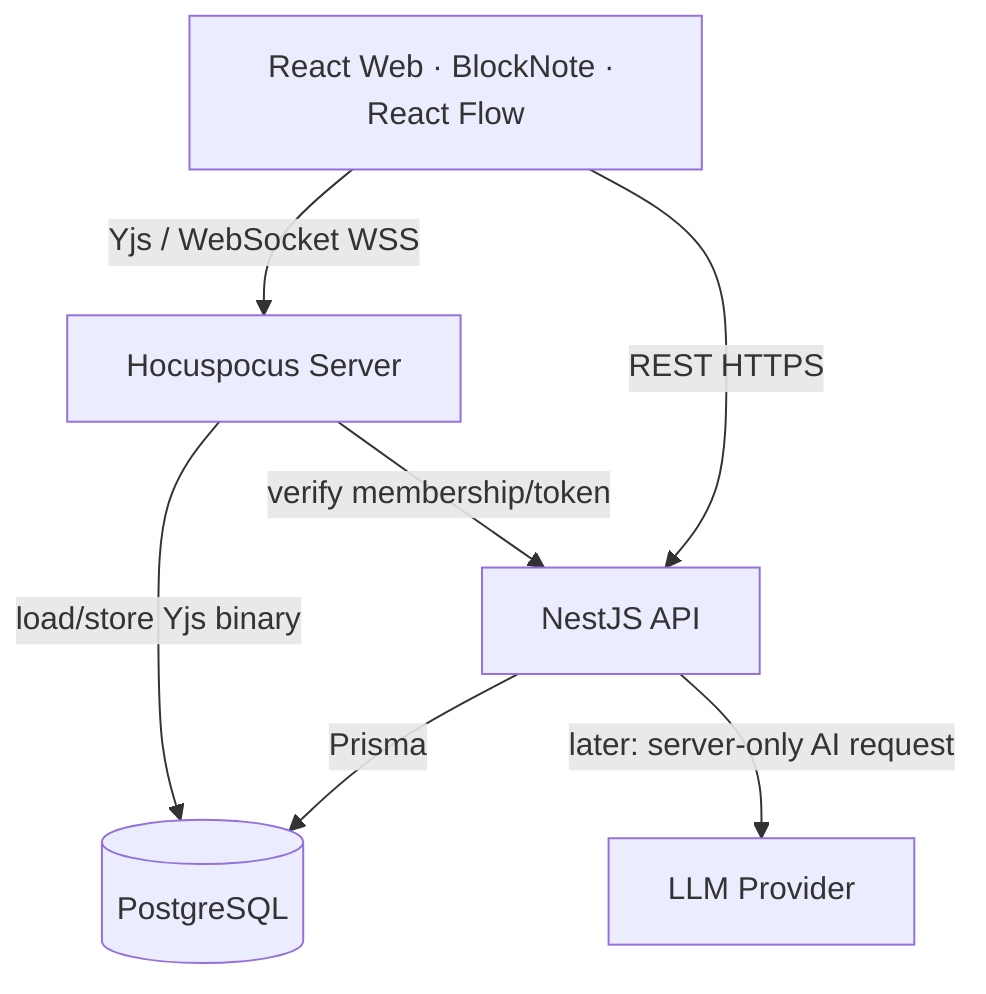
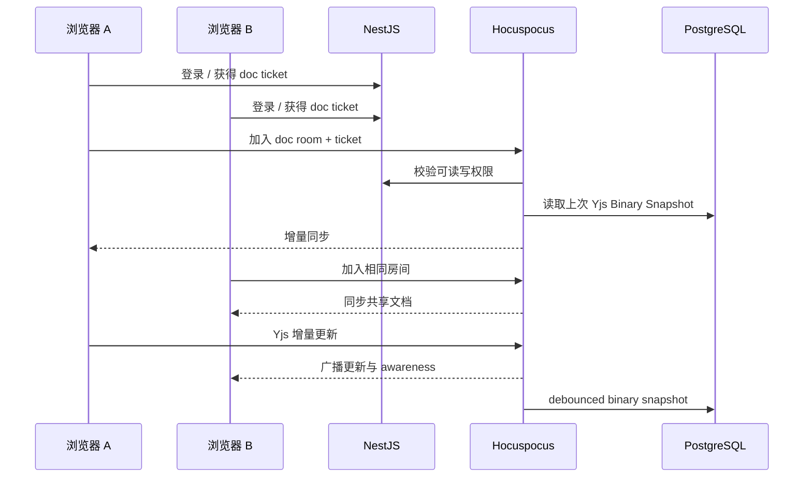
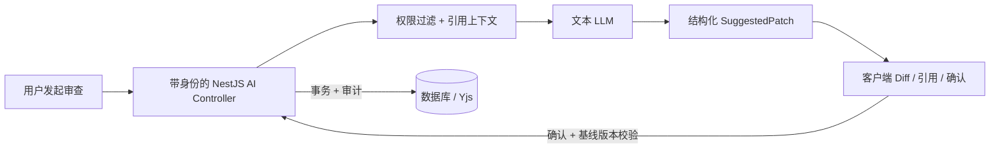

# Weavefield · 技术架构说明

> 状态：v0.1 设计基线（2026-10-20）。**当前仓库仅包含开发演示的 Web/HTTP/Collab 骨架，不代表以下生产能力已实现。**

## 1. 系统分层

**边界约束：**

- **Web：** 负责 UI、协作 Y.Doc、本地可视状态。只持有短期授权凭据，无服务端 API Key。
- **NestJS：** 工作空间、用户、邀请、角色权限、文档/任务/流程图元数据、AI 建议与操作审计的唯一业务入口。
- **Hocuspocus：** 维护在线 Yjs 连接、传输/合并 CRDT 更新、意识状态（cursor / presence）与快照。不是第二套业务 API。
- **PostgreSQL：** 业务关系与 Yjs 二进制持久化（目标）；`docSnapshots` 及 audit 提供恢复和排错基础。
- **packages/shared：** 跨端 DTO 与运行时校验，禁止客户端决定权限。

## 2. 开发与生产的安全边界

当前 `apps/collab` 是**强制仅 localhost + 强制拒绝 production**的开发演示服务；`COLLAB_DEV_TOKEN` 是测试配置，可在浏览器看到，不能代表真实身份。只用于验证两浏览器同步和 Yjs 文件快照。正式协同必须先落地下列流程：

1. Web 登录 NestJS，拿到访问令牌/安全会话。
2. 通过 `/documents/:id/collab-ticket` 请求**短期、绑定用户与 documentId** 的一次性或可限制的票据。
3. Hocuspocus `onAuthenticate` 对票据签名、过期、房间 ID、成员权限进行**服务端验证**，拒绝不匹配/已吊销成员。
4. viewer 必须从服务端禁止写入；仅仅禁用 BlockNote 的编辑按钮不够。
5. 用用户 ID + workspace ID + room ID 记录脱敏审计日志；建立速率限制和连接/文档大小上限。
6. 使用 WSS + 可信 Origin 校验 + 反向代理，严禁让匿名用户随便构造 room 订阅私有文档。

## 3. 实时文档的数据流

**持久化：** 用 `Y.encodeStateAsUpdate(ydoc)` 保存完整状态（`Uint8Array / Bytes`），读取时 `Y.applyUpdate`；不能在编辑后把 BlockNote JSON 重新生成一份新 Y.Doc 来充当持久数据，否则可能出现重复内容和 CRDT 历史异常。Presence 是临时状态，不应当保存进文档正文。

**本地演示：** 二进制 `.bin` 文件位于 `apps/collab/.local`。开发版默认写入不是业务数据库；仅验证 API 交互契约。M2 接入 PostgreSQL 时，删除 dev-only 读写逻辑和令牌后才能发布。

## 4. 文档 ↔ 流程图 ↔ 任务的统一业务身份

三个视图不应存三份独立的「登录需求」文本。核心做法：

- `Document` 有自己的 `docId` 和 `ydocRoomName`。
- BlockNote 中重要的需求块通过持久 ID（例如 `blockId` + `documentId`）建立 `RequirementRef`。
- `BoardNode` 拥有 `nodeId`（属于 board，带坐标、类型和 version）。
- `Task` 拥有 `taskId`、状态与负责人。
- `EntityLink` 以 `(sourceType, sourceId, targetType, targetId, relation)` 记录跨视图引用。

**不要将文档文字自动复制到流程图 / 任务并相互覆盖。** 关联保存 ID，UI 根据权限异步加载实体摘要。实体删除时应显式标记断链或清除，并提供 UI 提示。

## 5. 任务与图表同步的设计决策

- 第一版 React Flow 的节点布局从 API 获取并保存；后期共享编辑需要一个可验证的冲突模型。
- 不把 Y.Doc 直接当作所有业务数据的唯一存储；业务权限/状态/索引仍归 Postgres。
- 对任务 CRUD 可以先采用乐观锁 `version`、WebSocket 推送状态变化；流程画布若多人同改节点，后期使用 Yjs Map 或服务端串行化事件，并说明取舍。
- 保留 HTTP REST 请求用于 CRUD 和持久元数据，不使用纯广播替代持久层。

## 6. AI 协作架构（M4，尚未实现）

- 模型只返回建议，不拥有直接改文档或执行本地命令的能力。
- 建议应用必须携带 base version / 状态向量；冲突时提示重新计算或人工合并。
- 所有 LLM 请求从 NestJS 服务端发出。支持模型可替换与 token 预算，但 MVP 可以完全没有 AI。

## 7. 运维与部署建议

- Web 可静态部署；API 与 Collab 独立 Node 容器；Postgres 托管或 Docker。
- M2 单实例 Hocuspocus 起步，不急于引入 Redis。未来多实例时评估分布式 Yjs 同步与存储一致性。
- 日志：`traceId`、userId hash、workspaceId、roomId、请求耗时、错误码；敏感内容及 token 不进日志。
- CI：pnpm 缓存、构建、类型检查、单测、E2E（有容器环境后）。
- 监控：WebSocket 活跃连接数、存储失败次数、内容写入延迟、未授权请求、堆内存和文档尺寸。

## 8. 技术风险清单

| 风险 | 对策 |
|---|---|
| CRDT 文档重复/丢失 | Binary state；重启/断线/并发 E2E |
| WebSocket 权限漏洞 | 独立 `onAuthenticate` + membership query + write guard |
| 项目范围膨胀 | 按 Roadmap 门禁推进；先文档再流程和 AI |
| 富文本升级兼容性 | 锁文件 + 兼容测试，BlockNote v0.52+ 使用 `withCollaboration` |
| Hocuspocus v4 协议变更 | 统一 v4 provider/server，Node 22+，参考官方迁移指南 |
| 多视图状态漂移 | 关联稳定 ID，独立关系表，不复制文字 |
| AI 覆盖人类修改 | SuggestedPatch + 版本校验 + 人工确认 |

## 9. ADR

- [ADR-0001 NestJS 和 Hocuspocus 分离](decisions/ADR-0001-separate-api-and-collab.md)
- [ADR-0002 Yjs Binary 为协同权威状态](decisions/ADR-0002-yjs-binary.md)
- [ADR-0003 跨视图稳定实体关系](decisions/ADR-0003-entity-links.md)
