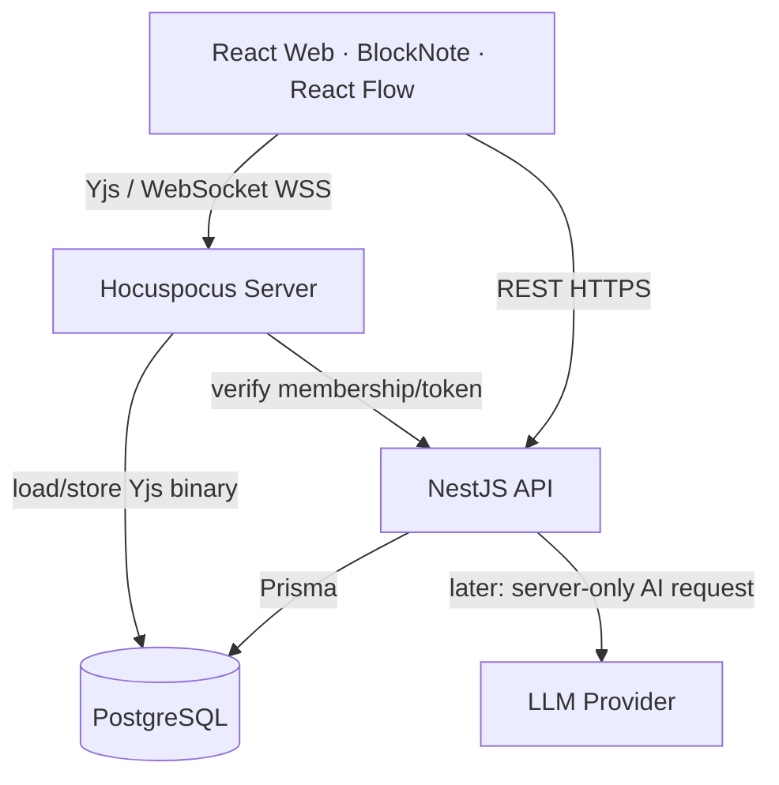
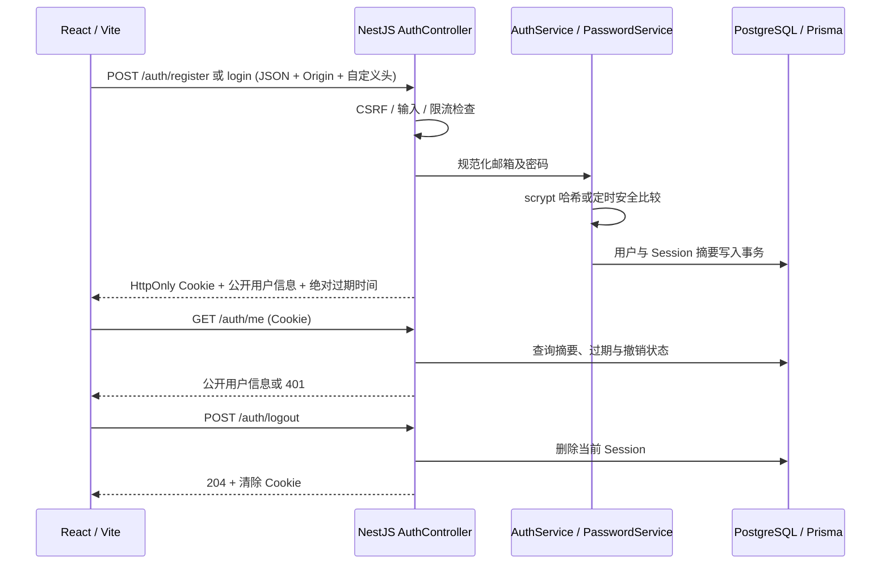
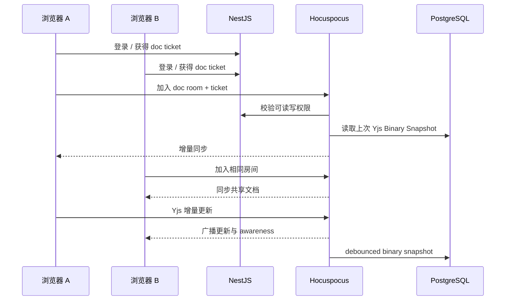
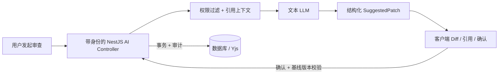

# Weavefield · 技术架构说明

> 状态：M1.1–M1.4 已合并且最终 main Linux CI 通过；M1.5 OpenAPI 与权限契约已本地实现，验证及人工审查状态见 [M1.5 报告](reports/M1.5.md)。**正式正文编辑、协作鉴权及 PostgreSQL 协作持久化仍未实现，以下协作生产流程仍为目标设计。**

## 1. 系统分层

**边界约束：**

- **Web：** 负责 UI、协作 Y.Doc、本地可视状态。只持有短期授权凭据，无服务端 API Key。
- **NestJS：** 工作空间、用户、邀请、角色权限、文档/任务/流程图元数据、AI 建议与操作审计的唯一业务入口。
- **Hocuspocus：** 维护在线 Yjs 连接、传输/合并 CRDT 更新、意识状态（cursor / presence）与快照。不是第二套业务 API。
- **PostgreSQL：** 业务关系与 Yjs 二进制持久化（目标）；`docSnapshots` 及 audit 提供恢复和排错基础。
- **packages/shared：** 跨端 DTO 与运行时校验，禁止客户端决定权限。

### M1.1 数据库基础设施

- `infra/docker-compose.yml` 使用 PostgreSQL 16，仅向 `127.0.0.1` 发布端口，命名卷保存数据，`pg_isready` 健康检查配合 `up --wait`；密码从被忽略的环境文件注入。开发与验收使用不同 Compose 项目、端口和数据库，操作前需确认卷归属。
- `packages/database/prisma/schema.prisma` 是模型定义的唯一来源；`prisma/migrations` 保存初始 SQL 与迁移历史定义。初始迁移包括 10 张现有草案表，没有删除后续模型；M1.2 另增认证迁移，不修改初始迁移。`db:deploy` 应用迁移，`db:generate` 将 Prisma 6.19.3 Client 生成到 `packages/database/generated/client`，生成物不入库。
- `packages/database/src/index.ts` 将生成类型与进程内共享 `prisma` 实例统一导出，编译为 CommonJS 供后续 NestJS 使用。导入不会立即连接；各服务管理连接生命周期，并为自身进程注入 `DATABASE_URL`。不同服务进程各有连接池，不共享跨进程单例。M1.2 的 DatabaseService 已通过 NestJS Provider 连接该实例，应用启用关闭钩子；M1.3 工作空间模块复用同一 Provider，不新建连接池。
- `Membership` 用 `(workspaceId, userId)` 复合主键防止重复成员；新增 `userId` 索引补足按用户查询和外键删除检查。Document 的 `(workspaceId, updatedAt)` 索引用于空间内文档列表。删除空间级联删除成员关系、文档及其快照；删除用户只删除成员关系，不删除工作空间。
- 数据库外键和唯一约束验证关系完整性，不能替代授权。Workspace 没有自动生成 owner 的数据库约束；M1.3 使用事务一起创建空间与 OWNER。M1.2 实现邮箱规范化，M1.3 在 Workspace / Membership 接口实施角色与租户检查，M1.4 已覆盖文档元数据，尚不覆盖 M2 协作连接等后续实体。
- DocumentSnapshot（`Bytes`）、Board、BoardNode、BoardEdge、Task、EntityLink 当前仅有表结构。BoardEdge 的端点 ID、Task 的 assigneeId 和 EntityLink 的多态引用尚无目标实体外键；启用这些业务前须验证对象存在、归属及删除策略。本轮未把普通二进制字段读写等同于 Yjs PostgreSQL 持久化。
- `packages/database/test/integration.cjs` 在显式指定的本机测试库验证真实迁移、CRUD、约束、事务和级联删除；测试不执行 reset，也不重启或清空用户已有数据库。服务重启持久化需在保留同一卷的情况下另行精确比较已提交记录。

### M1.2 认证数据流

数据库包实例由 DatabaseService 在 onModuleInit/onModuleDestroy 中连接和断开。Session 为随机不透明凭据，七天绝对过期；不把 Token 放进 React 状态、localStorage 或 JSON 响应。M1.3 将真实身份与会话刷新集中到 AuthProvider，AuthPanel 和 WorkspacePanel 共享状态，并处理过期、网络错误和请求竞争。Nova、协作演示访客及协作令牌仍与认证账号分离，登录不创建 Membership，不发放协作权限。

生产 Cookie、CSRF、防暴力尝试、旧数据兼容和当前限制统一记录在 [ADR-0004](decisions/ADR-0004-database-cookie-sessions.md)。本轮仍为单实例、loopback API，没有提供公网部署或共享限流。

### M1.3 工作空间与权限数据流

`WorkspacesModule` 复用 AuthModule / DatabaseModule。`SessionGuard` 严格解析 Cookie，调用 AuthService.me 验证过期与撤销，把已验证用户放入请求；写请求复用 Origin / JSON / 自定义头校验。Controller 校验字段白名单、名称、slug、角色及 ID，不接收客户端创建者。Service 明确 select 安全 DTO，不返回密码或 Session。

- 列表按当前用户 ID 查询 Membership；详情与成员读取在 RepeatableRead 事务内先检查 Membership，再读取同一快照。非成员与不存在空间均为相同 404，避免通过 ID 枚举区分存在性。
- 创建在同一事务内写 Workspace + OWNER Membership，任一步失败全部回滚。
- 名称和成员的所有写入在 ReadCommitted 事务内先 `SELECT ... FROM "Workspace" ... FOR UPDATE`，等待锁后重新读取操作者角色。仅 OWNER 继续；目标成员按 `(workspaceId,userId)` 读取，禁止跨租户引用。
- 删除或降级 OWNER 前计数；最后一个 OWNER 返回 409。有两位 OWNER 时允许自降级或退出。父行锁将同空间写入串行化，ReadCommitted 保证锁等待后的查询看见最新已提交状态，防止双降级、双退出以及已经被移除的操作者继续写入。
- `WorkspaceAccess.require` 接受事务 Client，集中成员与 OWNER 判断并由模块导出，由 M1.4 文档 API 复用，并在资源查询中进一步落实 workspace 归属；挂载 Guard 本身不能替代对象授权。

React 的 `AuthProvider` 是身份唯一来源。`WorkspacePanel` 按用户 ID 隔离实例，打开时加载列表与所选空间/成员；持久化仅为按用户分组的选择 ID，不存角色或成员信息。响应序号和组件生命周期检查丢弃旧请求；401 清理认证与受保护状态，404 移除失效选择，403 显示拒绝并重新加载真实角色。窗口打开期间提供手动、聚焦和每分钟刷新；没有成员变动推送。Nova 和 M0 编辑器保持静态演示，真实空间不关联这些共享文档。

当前约束只覆盖通过该 Service 的写入口。数据库本身没有“至少一位 OWNER”的跨行约束；直接 SQL、脚本或未来 User 删除的级联可绕过，新增入口必须沿用父行锁协议。还未提供 Workspace 删除、邮件邀请、协作票据或审计日志。并发与性能取舍见 [ADR-0005](decisions/ADR-0005-workspace-membership-rbac.md)。

### M1.4 文档元数据数据流

`DocumentsModule` 复用 AuthModule、DatabaseModule 与 WorkspacesModule 导出的 WorkspaceAccess。五个路由位于 `/workspaces/:workspaceId/documents` 下：列表 / 创建、`:documentId` 的详情 / 重命名、`:documentId/archive` 的软归档。SessionGuard 验证会话和写入来源；Controller 白名单校验标题和 ID；Service 只返回明确选择的元数据，不包含房间或认证字段。

- 列表和详情在 RepeatableRead 事务中先验证成员关系，随后按 workspaceId、archivedAt=null 查询，详情再限定 documentId。列表按 updatedAt 降序、id 升序；已开始的合法读可在撤权后完成，后续请求重新鉴权。
- 写入使用与成员管理相同的 Workspace 父行锁，ReadCommitted 下锁后重新验证角色。OWNER / EDITOR 可写，VIEWER 写入 403；非成员或错误空间 / 文档关系统一 404。
- 创建使用 `doc:${randomUUID()}` 作为内部 room，数据库唯一约束是最终防线。P2002 房间冲突最多尝试三次，每次开启新事务；不能在已被 PostgreSQL 中止的事务中重试。耗尽返回 409。
- 重命名和归档同时限定 workspaceId、documentId、archivedAt=null，使用条件更新并检查影响行数。归档仅写时间，不删除 DocumentSnapshot；归档后详情、重命名和重复归档均为 404。父行锁还保证排队期间被降级的写者按最新权限拒绝。
- `WorkspacePanel` 在真实空间内挂载 `DocumentsPanel`；按用户、空间及角色隔离组件，关闭面板即卸载。请求序号和存活检查丢弃过期响应，包括旧 401，避免清理新会话。写入成功后重新获取列表，401 清理身份、403 隐藏过期写入口、404 清理失效详情并重新请求列表：空间仍可读时保留其他文档；空间不可访问时清理受保护信息；网络失败显示错误，不显示为空列表。
- UI 只显示标题、编号与时间，明确正文编辑属于 M2。真实文档不创建 Y.Doc、provider 或快照；背景 M0 演示仍使用原演示路径，关闭面板可继续体验。

同空间写入串行化是沿用成员撤权协议的明确取舍；没有新增 Schema、Migration、连接池或权限框架。约束、替代方案和测试见 [ADR-0006](decisions/ADR-0006-document-metadata-and-archive.md)。

### M1.5 OpenAPI 与契约验证

`application.ts` 在创建应用时调用 `openapi/setup.ts`。仅当 ENABLE_OPENAPI_DOCS 精确为 1 且 NODE_ENV 为未设置 / development / test 时，SwaggerModule 扫描现有 Controller 元数据，注册 `/api-docs`（只浏览）与 `/openapi.json`。production 与未知模式强制关闭，不保留 JSON/YAML 别名或 UI 资源路由。现有 API 启动仍连接数据库；生成与读取契约不调用业务 Service、不建立 Session，也不写数据库。

`openapi/api-contract.ts` 只组合 Swagger 的文档装饰器；`openapi/schemas.ts` 用独立声明反映字段白名单、trim / Unicode 长度、枚举、安全响应和错误 DTO。没有安装 ValidationPipe、class-validator 或自动 DTO 转换。Schema 的字符长度不能替代 UTF-8 字节数和 JavaScript UTF-16 单元限制，因此密码的 256 字节、邮箱原始输入的 254 单元限制另在描述中明确，真实 HTTP 测试仍为行为依据。

认证声明为 `apiKey / cookie` 的 cookieSession。写请求沿用精确 Origin、JSON 和自定义头；文档路由不改变解析器、SessionGuard 或事务授权顺序。文档测试从 Nest Controller 元数据独立核对全部 18 个路由，对真实 HTTP 成功响应做 Schema 校验，并检查默认/生产关闭、字段保密和状态码优先级。原有数据库与权限并发测试继续验证业务边界。

Prisma Client 仍由 database build 单一生成，database typecheck 依赖本包 build；M1.5 不修改 Turbo 任务图，不在 OpenAPI 生成中调用 db:generate。分别执行的命令仍需顺序运行，不能由外部进程并发向同一生成目录写入。M1 文档元数据不提供正文读取、Hocuspocus 正式鉴权或 Yjs PostgreSQL 持久化；这三项仍属 M2。

## 2. 开发与生产的安全边界

当前 `apps/collab` 是**强制仅 localhost + 强制拒绝 production**的开发演示服务；`COLLAB_DEV_TOKEN` 是测试配置，可在浏览器看到，不能代表真实身份。只用于验证两浏览器同步和 Yjs 文件快照。正式协同必须先落地下列流程：

1. Web 登录 NestJS，拿到访问令牌/安全会话。
2. 通过 `/documents/:id/collab-ticket` 请求**短期、绑定用户与 documentId** 的一次性或可限制的票据。
3. Hocuspocus `onAuthenticate` 对票据签名、过期、房间 ID、成员权限进行**服务端验证**，拒绝不匹配/已吊销成员。
4. viewer 必须从服务端禁止写入；仅仅禁用 BlockNote 的编辑按钮不够。
5. 用用户 ID + workspace ID + room ID 记录脱敏审计日志；建立速率限制和连接/文档大小上限。
6. 使用 WSS + 可信 Origin 校验 + 反向代理，严禁让匿名用户随便构造 room 订阅私有文档。

## 3. 实时文档的数据流

**持久化：** 用 `Y.encodeStateAsUpdate(ydoc)` 保存完整状态（`Uint8Array / Bytes`），读取时 `Y.applyUpdate`；不能在编辑后把 BlockNote JSON 重新生成一份新 Y.Doc 来充当持久数据，否则可能出现重复内容和 CRDT 历史异常。Presence 是临时状态，不应当保存进文档正文。

**本地演示：** 二进制 `.bin` 文件位于 `apps/collab/.local`。开发版默认写入不是业务数据库；仅验证 API 交互契约。M2 接入 PostgreSQL 时，删除 dev-only 读写逻辑和令牌后才能发布。

## 4. 文档 ↔ 流程图 ↔ 任务的统一业务身份

三个视图不应存三份独立的「登录需求」文本。核心做法：

- `Document` 有自己的 `docId` 和 `ydocRoomName`。
- BlockNote 中重要的需求块通过持久 ID（例如 `blockId` + `documentId`）建立 `RequirementRef`。
- `BoardNode` 拥有 `nodeId`（属于 board，带坐标、类型和 version）。
- `Task` 拥有 `taskId`、状态与负责人。
- `EntityLink` 以 `(sourceType, sourceId, targetType, targetId, relation)` 记录跨视图引用。

**不要将文档文字自动复制到流程图 / 任务并相互覆盖。** 关联保存 ID，UI 根据权限异步加载实体摘要。实体删除时应显式标记断链或清除，并提供 UI 提示。

## 5. 任务与图表同步的设计决策

- 第一版 React Flow 的节点布局从 API 获取并保存；后期共享编辑需要一个可验证的冲突模型。
- 不把 Y.Doc 直接当作所有业务数据的唯一存储；业务权限/状态/索引仍归 Postgres。
- 对任务 CRUD 可以先采用乐观锁 `version`、WebSocket 推送状态变化；流程画布若多人同改节点，后期使用 Yjs Map 或服务端串行化事件，并说明取舍。
- 保留 HTTP REST 请求用于 CRUD 和持久元数据，不使用纯广播替代持久层。

## 6. AI 协作架构（M4，尚未实现）

- 模型只返回建议，不拥有直接改文档或执行本地命令的能力。
- 建议应用必须携带 base version / 状态向量；冲突时提示重新计算或人工合并。
- 所有 LLM 请求从 NestJS 服务端发出。支持模型可替换与 token 预算，但 MVP 可以完全没有 AI。

## 7. 运维与部署建议

- Web 可静态部署；API 与 Collab 独立 Node 容器；Postgres 托管或 Docker。
- M2 单实例 Hocuspocus 起步，不急于引入 Redis。未来多实例时评估分布式 Yjs 同步与存储一致性。
- 日志：`traceId`、userId hash、workspaceId、roomId、请求耗时、错误码；敏感内容及 token 不进日志。
- CI：独立 PostgreSQL 16 服务，Schema、数据库集成与升级、Auth / Workspace / Document API 集成、类型检查、单元测试、构建及完整 Playwright E2E。M1.4 最终 main Linux CI 39718582027 已通过；M1.5 新增 OpenAPI 契约检查，尚待人工审查和后续授权的远程 CI；失败产物仍仅上传既有白名单 Selection 数值 JSON，不上传原始 trace、截图或表单内容。
- 监控：WebSocket 活跃连接数、存储失败次数、内容写入延迟、未授权请求、堆内存和文档尺寸。

## 8. 技术风险清单

| 风险 | 对策 |
|---|---|
| CRDT 文档重复/丢失 | Binary state；重启/断线/并发 E2E |
| WebSocket 权限漏洞 | 独立 `onAuthenticate` + membership query + write guard |
| 项目范围膨胀 | 按 Roadmap 门禁推进；先文档再流程和 AI |
| 富文本升级兼容性 | 锁文件 + 兼容测试，BlockNote v0.52+ 使用 `withCollaboration` |
| Hocuspocus v4 协议变更 | 统一 v4 provider/server，Node 22+，参考官方迁移指南 |
| 多视图状态漂移 | 关联稳定 ID，独立关系表，不复制文字 |
| AI 覆盖人类修改 | SuggestedPatch + 版本校验 + 人工确认 |

## 9. ADR

- [ADR-0001 NestJS 和 Hocuspocus 分离](decisions/ADR-0001-separate-api-and-collab.md)
- [ADR-0002 Yjs Binary 为协同权威状态](decisions/ADR-0002-yjs-binary.md)
- [ADR-0003 跨视图稳定实体关系](decisions/ADR-0003-entity-links.md)
- [ADR-0004 数据库 Cookie Session](decisions/ADR-0004-database-cookie-sessions.md)

- [ADR-0005 Workspace 与 Membership RBAC 及并发 OWNER 保护](decisions/ADR-0005-workspace-membership-rbac.md)
- [ADR-0006 文档元数据、权限与软归档](decisions/ADR-0006-document-metadata-and-archive.md)
