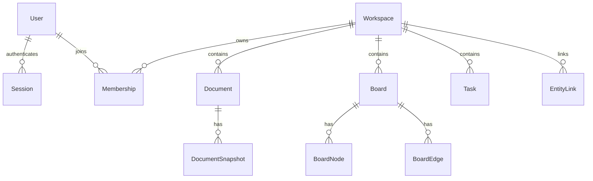

# Weavefield · 数据模型（v0.1 草案）

Schema: `packages/database/prisma/schema.prisma`。M1.1 增加全部草案表的初始 Migration 与统一 Prisma Client 入口（实际验收见 [报告](reports/M1.1.md)）；M1.2 新增认证迁移、AuthService 和数据库 Provider；工作空间业务与租户授权尚未实现。

## 关系模型

## 表的职责

| 表 | 职责 | 重要字段 |
|---|---|---|
| User | 平台用户 | id / email / emailCanonical unique / displayName / passwordHash? |
| Session | 七天绝对有效的服务端会话 | tokenHash unique / userId / expiresAt index / revokedAt |
| Workspace | 工作空间 | id / slug / name |
| Membership | 多租户成员与角色 | (workspaceId,userId) unique；OWNER/EDITOR/VIEWER |
| Document | 文档元数据 | id / workspaceId / title / ydocRoomName |
| DocumentSnapshot | Yjs binary 历史快照（仅表结构） | documentId / revision / binaryState Bytes |
| Board | 流程画布 | id / workspaceId / title |
| BoardNode | 画布节点状态 | id / boardId / kind / x / y / data / version |
| BoardEdge | 节点连接 | id / boardId / sourceId / targetId |
| Task | 工作任务 | id / workspaceId / title / status / version |
| EntityLink | 跨视图关联 | sourceType/id / targetType/id / relation |

## 数据一致性与权限

- workspace 是所有业务实体的租户边界；API 操作都必须带 `workspaceId` 过滤/校验，不能仅凭实体 ID 查询。
- Membership 的复合主键防止同一用户重复加入同一空间，`userId` 索引用于从用户查空间；删除用户级联清理成员关系，删除空间级联清理空间内记录。数据库不保证每个空间自动拥有 OWNER，业务创建流程还需事务。
- EntityLink 应由服务端检查源、目标实体均存在且属于相同 workspace。
- `documentId` 映射唯一 room 名；如果文档被删除/归档，Collab 应拒绝写入并关闭连接。
- `DocumentSnapshot.binaryState` 保存完整 CRDT 状态，允许幂等恢复；以后可改为最新快照 + 增量日志，必须确保顺序。
- `BoardNode.version`、`Task.version` 供 HTTP 乐观锁使用，冲突返回 409。
- 数据表内不要存模型 API Key 或明文用户凭证。

## 实现提醒

Prisma 的关系建模并不会自动替代授权逻辑。必须有请求级 Guard / Service ACL。数据库事务也不代替 Yjs 协同状态的合并语义。参考 `docs/ARCHITECTURE.md`。

## M1.2 认证迁移

新增 emailCanonical 和 passwordHash 均可空，以保留旧用户及 M1.1 的数据库操作兼容性。认证注册始终写入规范化邮箱和 scrypt 摘要；迁移回填旧邮箱 canonical，保留原 email。旧账号 passwordHash=null，没有默认密码，不能登录。规范化冲突在 DDL 前阻止升级，其余变更与回填使用事务。

Session.userId 外键随 User 删除而级联，Session.tokenHash 为随机 Token 的 SHA-256 摘要，无法直接作为 Cookie 使用。认证查询要求 expiresAt 在未来且 revokedAt 为空；退出删除当前记录。过期/撤销记录的批量清理尚未实现，不可将 Session 当作租户或文档授权。
