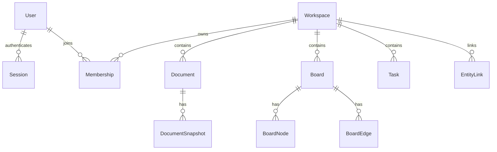

# Weavefield · 数据模型（v0.1 草案）

Schema: `packages/database/prisma/schema.prisma`。M1.1 增加全部草案表的初始 Migration 与统一 Prisma Client 入口（实际验收见 [报告](reports/M1.1.md)）；M1.2 新增认证迁移、AuthService 和数据库 Provider；M1.3 复用 Workspace / Membership 实现业务与租户 RBAC；M1.4 复用 Document 实现元数据管理。M1.3 / M1.4 均无 Schema 或 Migration 变更，正式协作授权尚未实现。

## 关系模型

## 表的职责

| 表 | 职责 | 重要字段 |
|---|---|---|
| User | 平台用户 | id / email / emailCanonical unique / displayName / passwordHash? |
| Session | 七天绝对有效的服务端会话 | tokenHash unique / userId / expiresAt index / revokedAt |
| Workspace | 工作空间 | id / slug / name |
| Membership | 多租户成员与角色 | (workspaceId,userId) unique；OWNER/EDITOR/VIEWER |
| Document | 空间内文档元数据与软归档 | id / workspaceId / title / ydocRoomName unique / createdAt / updatedAt / archivedAt? |
| DocumentSnapshot | Yjs binary 历史快照（仅表结构） | documentId / revision / binaryState Bytes |
| Board | 流程画布 | id / workspaceId / title |
| BoardNode | 画布节点状态 | id / boardId / kind / x / y / data / version |
| BoardEdge | 节点连接 | id / boardId / sourceId / targetId |
| Task | 工作任务 | id / workspaceId / title / status / version |
| EntityLink | 跨视图关联 | sourceType/id / targetType/id / relation |

## 数据一致性与权限

- workspace 是所有业务实体的租户边界；API 操作都必须带 `workspaceId` 过滤/校验，不能仅凭实体 ID 查询。
- Membership 的复合主键防止同一用户重复加入同一空间，`userId` 索引用于从用户查空间；删除用户级联清理成员关系，删除空间级联清理空间内记录。数据库不保证每个空间自动拥有 OWNER；M1.3 创建事务同时写空间和 OWNER，后续成员变更通过父行锁保护最后 OWNER。
- EntityLink 应由服务端检查源、目标实体均存在且属于相同 workspace。
- `documentId` 映射唯一 room 名；如果文档被删除/归档，Collab 应拒绝写入并关闭连接。
- `DocumentSnapshot.binaryState` 保存完整 CRDT 状态，允许幂等恢复；以后可改为最新快照 + 增量日志，必须确保顺序。
- `BoardNode.version`、`Task.version` 供 HTTP 乐观锁使用，冲突返回 409。
- 数据表内不要存模型 API Key 或明文用户凭证。

## 实现提醒

Prisma 的关系建模并不会自动替代授权逻辑。必须有请求级 Guard / Service ACL。数据库事务也不代替 Yjs 协同状态的合并语义。参考 `docs/ARCHITECTURE.md`。

## M1.2 认证迁移

新增 emailCanonical 和 passwordHash 均可空，以保留旧用户及 M1.1 的数据库操作兼容性。认证注册始终写入规范化邮箱和 scrypt 摘要；迁移回填旧邮箱 canonical，保留原 email。旧账号 passwordHash=null，没有默认密码，不能登录。规范化冲突在 DDL 前阻止升级，其余变更与回填使用事务。

Session.userId 外键随 User 删除而级联，Session.tokenHash 为随机 Token 的 SHA-256 摘要，无法直接作为 Cookie 使用。认证查询要求 expiresAt 在未来且 revokedAt 为空；退出删除当前记录。过期/撤销记录的批量清理尚未实现，不可将 Session 当作租户或文档授权。

## M1.3 Workspace / Membership 业务约束

User 经 Membership 与 Workspace 构成多对多关系：同一用户可加入多个空间，同一空间可有多个 OWNER / EDITOR / VIEWER。列表按当前 Session 用户过滤；成员接口用复合主键同时限定空间和目标用户。OWNER 管理空间名称及成员；EDITOR / VIEWER 只能读取空间管理接口。M1.4 另允许 EDITOR 写文档元数据，VIEWER 只读。

空间 slug 保持数据库唯一，重复创建返回 409。添加成员按规范化邮箱找到有密码的注册账号，不建立待邀请用户，不发送邮件；复合主键拒绝重复添加。所有响应只选择空间 id/name/slug/createdAt/当前角色，或成员 role/createdAt/公开用户 id/email/displayName。

所有空间名称、成员新增、角色修改和移除先在 ReadCommitted 事务内锁定 Workspace 父行，锁后验证操作者并读取目标角色及 OWNER 数量；最后 OWNER 不可删除或降级。这样无需修改历史 Migration，也能协调跨 API 进程的写入。直接数据库写入和 User 删除级联不自动遵守该协议，仍可能导致无 OWNER 空间；本轮没有用户删除或空间删除 API，未来入口必须先处理这一约束。详见 [ADR-0005](decisions/ADR-0005-workspace-membership-rbac.md)。

## M1.4 Document 元数据与软归档

Document 通过 workspaceId 外键属于一个空间，以稳定 id 作为业务身份。title 仅为标题，不能解释为持久化正文。ydocRoomName 由服务端随机生成并受现有唯一约束保护，是 M2 的内部映射预留；不会通过元数据 DTO 暴露，也不授予协作访问权限。

现有字段、`@updatedAt`、workspaceId/updatedAt 索引及唯一约束已满足本阶段需求，故没有新增或修改 Migration。默认只查询 archivedAt=null 的记录，列表更新时间降序、id 升序。详情和修改均同时限定空间、文档与未归档条件，先验证真实成员角色。

归档设置 archivedAt，连同 updatedAt 更新；不物理删除 Document，不触发外键级联，不删除 DocumentSnapshot、Membership、Workspace 或其他文档。归档后列表排除该记录，详情 / 重命名 / 重复归档均返回 404。所有文档写入与成员变更共享父行锁，防止排队撤权和归档 / 改名竞态；重命名没有清除 archivedAt 的写路径。

DocumentSnapshot 在本阶段仍仅有表结构，API 不写 binaryState；测试使用二进制探针验证软归档原样保留快照，这不代表实现了 Yjs PostgreSQL 持久化或重启恢复。恢复归档、物理删除和快照 UI 未实现。详见 [ADR-0006](decisions/ADR-0006-document-metadata-and-archive.md)。
